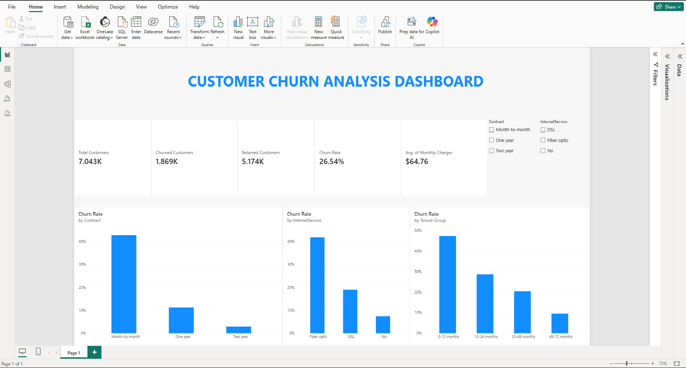

# Customer Churn Analysis | Python & Power BI

## Project Overview

This project analyzes customer churn in a telecommunications dataset using Python and Microsoft Power BI. The goal is to understand why customers may leave a telecommunications service, identify customer segments with higher churn rates, and provide data-driven recommendations to improve customer retention.

The project combines Python-based exploratory data analysis (EDA), data cleaning, visualizations, business insights, and an interactive Power BI dashboard.

## Objectives

- Calculate overall customer churn and retention rates.
- Analyze churn patterns across different contract types.
- Compare customer churn by internet service.
- Understand the relationship between customer tenure and churn.
- Identify customer segments with higher churn rates.
- Build an interactive Power BI dashboard.
- Provide actionable business recommendations.

## Technologies Used

**Programming and Data Analysis**
- Python
- Pandas
- NumPy

**Data Visualization**
- Matplotlib
- Seaborn
- Microsoft Power BI

**Business Intelligence**
- DAX (Data Analysis Expressions)
- KPI calculations
- Interactive slicers and filters

**Development Tools**
- Visual Studio Code
- Git
- GitHub

## Dataset

The project uses the IBM Telco Customer Churn dataset.

The original dataset contains 7,043 customer records and includes information about:

- Customer demographics
- Contract types
- Internet services
- Monthly charges
- Total charges
- Customer tenure
- Churn status

Dataset source: [Telco Customer Churn — Kaggle](https://www.kaggle.com/datasets/blastchar/telco-customer-churn)

The dataset is used for educational and portfolio purposes. Refer to the original dataset source for licensing and redistribution information.

## Data Cleaning and Preprocessing

The Python analysis performs the following preprocessing steps:

1. Loads the telecommunications customer dataset.
2. Removes unnecessary spaces from column names.
3. Converts `TotalCharges` into a numeric data type.
4. Removes duplicate records.
5. Removes rows containing missing `TotalCharges` values.
6. Creates a numeric churn indicator.
7. Groups customers into tenure categories for analysis.

After preprocessing, the Python analysis contains **7,032 customer records**.

The Power BI dashboard uses the original dataset containing **7,043 customer records**.

## Python Analysis Results

| Metric | Result |
|---|---:|
| Customers Analyzed | 7,032 |
| Churned Customers | 1,869 |
| Retained Customers | 5,163 |
| Customer Churn Rate | 26.58% |
| Average Monthly Charges | $64.80 |
| Average Customer Tenure | 32.4 months |

## Key Business Insights

### 1. Churn Rate by Contract Type

| Contract Type | Churn Rate |
|---|---:|
| Month-to-month | 42.71% |
| One year | 11.28% |
| Two year | 2.85% |

**Insight:** Customers with month-to-month contracts have substantially higher churn rates than customers with longer-term contracts.

**Recommendation:** Consider targeted retention offers and incentives for customers with month-to-month contracts.

### 2. Churn Rate by Internet Service

| Internet Service | Churn Rate |
|---|---:|
| Fiber optic | 41.89% |
| DSL | 19.00% |
| No internet service | 7.43% |

**Insight:** Customers using fiber optic internet have the highest observed churn rate.

**Recommendation:** Investigate customer satisfaction, pricing, and service quality among fiber optic customers.

### 3. Churn Rate by Customer Tenure

| Customer Tenure | Churn Rate |
|---|---:|
| 0–12 months | 47.68% |
| 13–24 months | 28.71% |
| 25–48 months | 20.39% |
| 49–72 months | 9.51% |

**Insight:** Customers in their first year have the highest churn rate, while long-term customers are less likely to leave.

**Recommendation:** Improve customer onboarding, early engagement, and support during the first year.

These findings identify associations in the dataset and do not establish causation.

## Python Visualizations and Reports

The Python script generates three visualizations:

1. Customer Churn Distribution
2. Churn Rate by Contract Type
3. Churn Rate by Customer Tenure

It also exports three CSV summary reports:

- `contract_churn_summary.csv`
- `internet_churn_summary.csv`
- `tenure_churn_summary.csv`

All generated charts and reports are stored in the `charts/` directory.

## Interactive Power BI Dashboard

An interactive Customer Churn Analysis Dashboard was developed using Microsoft Power BI Desktop.

The dashboard provides an overview of customer churn, retention, monthly charges, and customer behavior across different segments.

### Dashboard Preview



### Dashboard Key Performance Indicators

| KPI | Value |
|---|---:|
| Total Customers | 7,043 |
| Churned Customers | 1,869 |
| Retained Customers | 5,174 |
| Customer Churn Rate | 26.54% |
| Average Monthly Charges | $64.76 |

### Dashboard Visualizations

The dashboard includes three interactive charts:

**1. Churn Rate by Contract Type**

Compares customer churn rates across month-to-month, one-year, and two-year contracts.

**2. Churn Rate by Internet Service**

Analyzes churn rates among DSL, fiber optic, and customers without internet service.

**3. Churn Rate by Customer Tenure**

Displays churn patterns across four customer tenure groups.

### Interactive Dashboard Filters

Two slicers allow users to explore different customer segments.

**Contract Type Slicer**
- Month-to-month
- One year
- Two year

**Internet Service Slicer**
- DSL
- Fiber optic
- No internet service

Selecting a filter automatically updates the dashboard's KPI cards and charts.

### Power BI Skills Demonstrated

- CSV data import
- Data modeling
- DAX measure creation
- Calculated columns
- KPI development
- Interactive dashboard design
- Data visualization
- Slicers and dynamic filtering
- Business intelligence reporting

### Data Processing Note

The Python analysis uses 7,032 customer records after removing rows with missing or invalid `TotalCharges` values.

The Power BI dashboard uses the original dataset containing 7,043 customer records.

Therefore, some KPI values differ slightly between the Python analysis and Power BI dashboard.

## Project Structure

```text
customer-churn-analysis/
│
├── data/
│   └── WA_Fn-UseC_-Telco-Customer-Churn.csv
│
├── charts/
│   ├── churn_distribution.png
│   ├── churn_by_contract.png
│   ├── churn_by_tenure.png
│   ├── contract_churn_summary.csv
│   ├── internet_churn_summary.csv
│   └── tenure_churn_summary.csv
│
├── dashboard/
│   ├── Customer_Churn_Dashboard.pbix
│   └── Customer_Churn_Dashboard.png
│
├── analysis.py
├── requirements.txt
├── README.md
└── .gitignore
```

## How to Run the Python Analysis

### 1. Clone the Repository

```powershell
git clone https://github.com/krishnakolli1/customer-churn-analysis.git
cd customer-churn-analysis
```

### 2. Create a Virtual Environment

```powershell
python -m venv .venv
```

### 3. Activate the Virtual Environment

```powershell
.\.venv\Scripts\Activate.ps1
```

### 4. Install Dependencies

```powershell
pip install -r requirements.txt
```

### 5. Add the Dataset

Place the IBM Telco Customer Churn dataset inside the `data/` folder.

The expected filename is:

`WA_Fn-UseC_-Telco-Customer-Churn.csv`

### 6. Run the Analysis

```powershell
python analysis.py
```

The script will display customer churn metrics, generate charts, and export summary reports.

## How to Open the Power BI Dashboard

1. Install Microsoft Power BI Desktop.
2. Clone or download this repository.
3. Navigate to the `dashboard/` folder.
4. Open `Customer_Churn_Dashboard.pbix`.
5. Use the Contract and Internet Service slicers to explore customer churn patterns.

If Power BI cannot locate the source CSV after cloning the repository, update the dataset path in Power BI's data source settings and refresh the report.

## Business Recommendations

Based on the analysis:

1. **Improve Customer Onboarding:** Provide additional support and engagement during the first 12 months.
2. **Focus on Month-to-Month Customers:** Explore retention incentives and longer-term contract benefits.
3. **Investigate Fiber Optic Churn:** Evaluate customer satisfaction, pricing, and service quality.
4. **Monitor Customer Retention:** Track churn metrics regularly using interactive dashboards.
5. **Develop Targeted Retention Strategies:** Prioritize customer segments with higher observed churn rates.

## Skills Demonstrated

- Python programming
- Data cleaning and preprocessing
- Exploratory data analysis (EDA)
- Pandas data manipulation
- Data aggregation and KPI calculations
- Customer churn analysis
- Matplotlib and Seaborn visualizations
- Power BI dashboard development
- DAX measures and calculated columns
- Interactive business intelligence reporting
- Business insights and recommendations
- Git and GitHub version control

## Conclusion

This project demonstrates how Python and Power BI can be combined to analyze customer churn and communicate business insights.

The Python analysis identifies patterns in customer behavior, while the Power BI dashboard provides an interactive way to explore churn metrics and customer segments.

The findings can help inform customer retention strategies and highlight areas for further investigation.